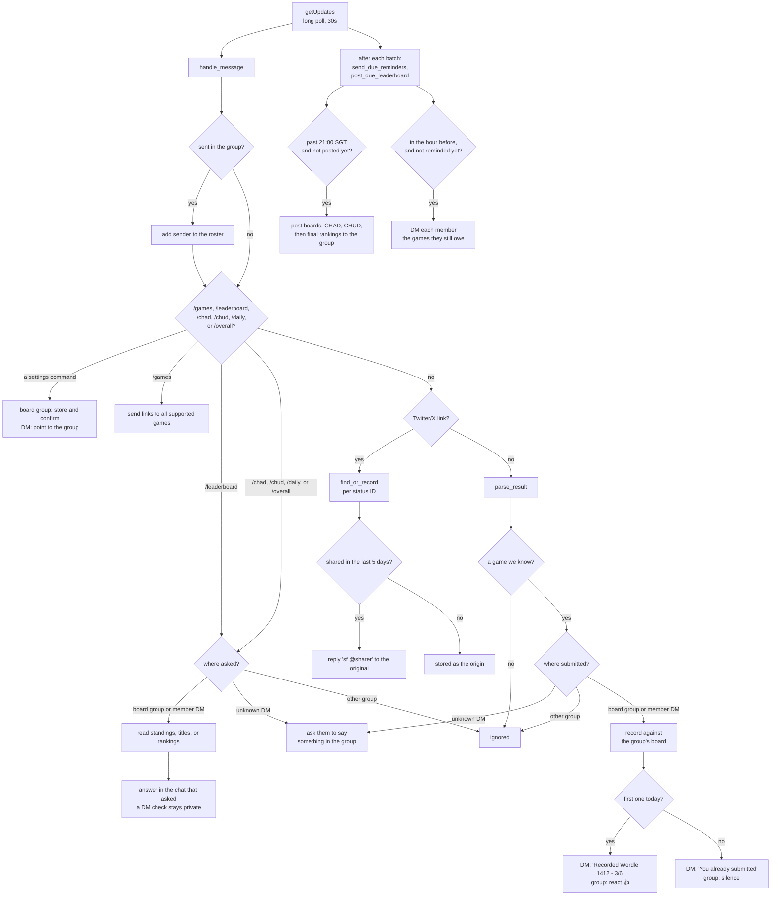

# sfbot

`sfbot` does two things for a Telegram group: it calls out repeated Twitter/X
posts, and it collects everyone's daily puzzle-game results by direct message so
the group gets a leaderboard and daily winner announcements instead of everyone's
share text.

## Repeated links

`sfbot` watches a Telegram group for Twitter/X status links. If the same post
was shared in that chat during the previous five days, it sends `sf @username`
as a reply to the first message. The mention names the person who shared the
duplicate; tapping the reply navigates to the original share. People without a
username get a clickable name mention instead.

Setting `SFBOT_ACTION_WORD` adds a callout naming whoever reposted. With
`SFBOT_ACTION_WORD=Nuke`, Alice sharing a post and Bob resharing it gets:

```
sf @Bob                                     (a reply to Alice's message)
Uh oh! Looks like Bob's being Sent to Nuke     ("Sent to Nuke" in bold)
Let's drop a /SendBobToNuke
SF leaderboard
1. Bob - 🏆🆕 1 SF
```

The "Uh oh!" line is picked at random from the `callout` message set, which the
group can extend; see [Message sets](#message-sets). The `/Send…To…` line is
fixed.

Each successful SF adds one to the repeat poster's lifetime count in that chat.
The SF leaderboard is the final message in the response. 🏆 marks the leader
(or tied leaders), and 🆕 marks the count that just increased. Both appear in
the same column beside the count. `/sf` shows the
same leaderboard on demand without 🆕. The SF leaderboard is separate from the
daily games post and is never included in that scheduled post. In a group,
`/sf` shows that group's counts; in a DM, it shows the configured games group's
counts after the sender has been seen in that group. Counts start when this
feature is installed; earlier SF replies cannot be reconstructed.

The past tense is the word plus `d`, so the word is expected to end in `e`. Text
between asterisks in a callout line (`*bold*` or `**bold**`) is sent as bold.
The bot uses message entities rather than a `parse_mode`, so nothing in a
display name ever needs escaping; a line with unpaired asterisks keeps them.

The name is the person's Telegram first name unless `SFBOT_NICKNAMES` gives one
for them; see [Nicknames](#nicknames).

Links are matched by numeric status ID within each chat. Twitter/X domains,
usernames, mobile subdomains, tracking parameters, and `/photo/1` suffixes do
not affect matching. The first share remains the reply target for five days.
Text, media captions, and hidden links are supported; `t.co` links are not resolved.

## Nicknames

Some people go by something other than their Telegram name. `SFBOT_NICKNAMES`
holds comma-separated `user_id:nickname` pairs and overrides the Telegram name
everywhere the bot names someone — the `sf` reply's mention, the repeat-poster
callout, the leaderboard, and the CHAD and CHUD announcements — so Bob who goes
by Juan gets `/SendJuanToNuke`:

```dotenv
SFBOT_NICKNAMES=123456789:Juan,987654321:Nikki
```

Find numeric user IDs in the debug logs:

```sh
SFBOT_LOG_LEVEL=DEBUG make run
# ... Message from user 123456789 (Bob)
```

Anyone without an entry keeps their Telegram name. Nicknames can also be set
from the group with `/nickname`, which needs no user ID or restart; see
[Changing settings from the chat](#changing-settings-from-the-chat). A change to
`SFBOT_NICKNAMES` itself needs a restart. The current nickname also appears for scores submitted
before the change, and for a CHAD or CHUD announcement repeated after it: the
winner is stored by user ID, so `/chad` and `/chud` name them the way the bot
would name them today. A day posted before that was recorded has only the
message it sent, so the names in it are swapped for nicknames where they still
belong to one player of that day.

## Changing settings from the chat

Anyone in the leaderboard group can change these settings by command, without
touching `.env` or restarting the bot. The bot answers in the group, so everyone
sees the change. A value set this way is stored in the database and wins over
the environment variable, which stays the default until a command sets one.

| Command | Effect | Default from |
| --- | --- | --- |
| `/settings` | Show the current values and nicknames | |
| `/actionword Gulag` | Set the callout word; `off` sends only the `sf` mention | `SFBOT_ACTION_WORD` |
| `/nickname Juan` | Set your own nickname, or, as a reply to someone's message, theirs; `off` clears it | `SFBOT_NICKNAMES` |
| `/posttime 21:30` | Set the daily post time; `off` stops the post and reminders | `SFBOT_LEADERBOARD_AT` |
| `/retention 7` | Set the duplicate-link window in days | `SFBOT_RETENTION_DAYS` |
| `/monthlyreset off` | Turn the monthly `/overall` reset `on` or `off` | on |
| `/resetoverall` | Post the final `/overall` standings, then start the totals again from today | |

Each command without a value shows the current one. In a DM the bot asks you to
use the group instead; other groups are ignored. Moving the post time after
today's post has gone out does not post it again.

A reset starts a new season: `/overall` totals and CHAD and CHUD streaks count
only days from its start. If today's board has already been posted, the new
season starts tomorrow, so today stays in the closing standings. With monthly
resets on, the bot resets on the first poll of each month, starting the season
on the 1st. The first month the bot sees is only recorded, so a fresh install,
or turning monthly resets on, keeps the current season until the next month.

Every reset also saves the closing season in SQLite, with its start and end dates,
the winner IDs and standings, and the exact text of its final board. `/seasons`
lists closed seasons ten at a time with their first-place players. Use
`/seasons <page number>` for older seasons, `/overall <season ID>` to retrieve a
saved final board, or `/overall last` for the newest. `/overall` without an
argument still shows the current season. These read commands work in the board
group and by DM for members on its roster.
Names in a saved final board do not change when nicknames change later. A reset
that closes a season without titles sends the reset notice but no final board;
the empty season can still be found with `/seasons`.

On the first run after this feature is installed, titles before an already
recorded `season_start` are saved as one **legacy, reconstructed** period. Older
individual season boundaries were not stored, so the bot cannot split that
period into separate seasons or recover the exact messages previously posted.
The bot saves each new final board before sending it and resumes unsent messages
after a restart. If Telegram delivers a message but its response is lost, a
retry can still duplicate that message.

### Message sets

The callout line and the CHAD and CHUD closing lines are each drawn from a set of lines
that the group can edit with commands. Anyone in the board group can use them,
in the group or by DM to the bot; a DM works only for people on the roster.

| Set | Used for |
| --- | --- |
| `callout` | The "Uh oh!" line; `{name}` is the reposter, `{word}` the action word |
| `chad` | CHAD closing lines for one winner or several |
| `chad-solo` | Extra CHAD closing lines for a single winner |
| `chad-group` | Extra CHAD closing lines for a tie |
| `chud` | CHUD closing lines |

| Command | Effect |
| --- | --- |
| `/lines callout` | List the set's lines, numbered |
| `/addline callout {name} is off to {word}` | Add a line to the set |
| `/delline callout 2` | Delete line 2 of the set |
| `/addline chad @Juan Nice job!` | Add a line to Juan's own CHAD lines |
| `/lines chud @Juan`, `/delline chud @Juan 1` | List or delete Juan's own CHUD lines |
| `/names` | List the names each member answers to |

CHAD and CHUD lines can also belong to one person. On a day they win, their own
lines join the group's in the pool the closing line is drawn from. After `@`,
use a member's nickname, Telegram name or username, in any case; `/names` lists
them. A name with spaces is read whole, and a name two people share is refused.
Someone's own lines start empty and may be deleted down to none.

The bot refuses to delete a set's last line, and refuses callout lines with
placeholders other than `{name}` and `{word}`. The sets start from the lines in
the code the first time the bot runs, and edits are kept from then on. A posted
CHAD or CHUD keeps its closing line, so `/chad` and `/chud` repeat it even after
the set changes.

## Architecture

One process, one SQLite file, no inbound network. Commands, repeated links, and
game results are handled as separate paths; the daily post is checked once per
polling cycle.



Members can submit results by DM without posting their share text to the group.

## Prerequisites

The shared Telegram bot already exists, has Group Privacy disabled, and has
been added to the group. Obtain its token securely from the maintainer and put
it in an uncommitted `.env` file:

```dotenv
TELEGRAM_BOT_TOKEN=replace-with-the-real-token
SFBOT_LEADERBOARD_CHAT_ID=-1001234567890
SFBOT_ACTION_WORD=Nuke
SFBOT_NICKNAMES=123456789:Juan,987654321:Nikki
```

`SFBOT_LEADERBOARD_CHAT_ID` is the group the daily leaderboard posts to; see
[Finding the group's chat ID](#finding-the-groups-chat-id). Leave it out to run
link deduplication and `/games` without the leaderboard. `SFBOT_ACTION_WORD` is
the repeat-poster callout verb; leave it out to send only the `sf` mention.

`compose.yaml` passes each of these into the container by name, so a new
variable has to be added there as well as to `.env`.

Never commit or post the token. Only one instance may use it at a time because
Telegram permits only one active `getUpdates` poller per bot.

## Run locally

Python 3.11 or newer and Make are required. The bot has no third-party runtime
dependencies. From the repository root, run:

```sh
make run
```

If the Python.org macOS installation reports `CERTIFICATE_VERIFY_FAILED`, use
the installed `certifi` bundle:

```sh
SSL_CERT_FILE="$(python3.11 -m certifi)" make run
```

Stop the bot with `Ctrl+C`. The local cache is stored at `data/sfbot.db`.

Use `make test` for unit tests or `make check` for tests and bytecode compilation.
The Makefile defaults to `python3.11`; override it with
`make check PYTHON=python3.12` when needed.

## Run on the homelab

Run the production instance as one Docker container on the group's homelab.
It uses Telegram long polling, so the host needs outbound HTTPS access but no
domain, reverse proxy, port forwarding, or inbound port.

After cloning the repository, create `.env` as shown above and run:

```sh
chmod 600 .env
docker compose up -d --build
docker compose ps
make logs
```

Docker's `restart: unless-stopped` policy restarts the bot after a crash or host
reboot, provided the Docker service starts at boot. The `sfbot-data` named
volume preserves `/data/sfbot.db` across container rebuilds.

To deploy a new revision:

```sh
git pull
docker compose up -d --build
make logs
```

When a rebuilt bot starts, it posts a changelog to the leaderboard group: the
title of each pull request merged to `main` since the last version it announced.
The image records the last 30 commits on `main`'s first-parent history at build
time, so build from a clone with its `.git` folder. The first start only records
the version, so a fresh install does not post the whole history. Set
`SFBOT_CHANGELOG_PATH` empty to turn the changelog off.

## One-bot development workflow

Never run the homelab and local instances simultaneously. Before a live local
test, stop production on the homelab:

```sh
docker compose stop sfbot
```

Run the bot locally with `make run`, stop it with `Ctrl+C`, then restore
production on the homelab:

```sh
docker compose start sfbot
```

Local testing uses a separate SQLite database, so production may not remember
links consumed while the local instance was active. This is acceptable for the
bot's short, non-critical five-day history.

## Daily games leaderboard

Wordle, Connections, Krillion, and Fermi are supported. DM the bot your game's
share text and it confirms the recorded result:

```text
you: Wordle 1,412 3/6
bot: Recorded Wordle 1412 - 3/6
```

Only people the bot has seen speaking in the configured group can submit or
read standings by DM. Say anything in the group to join the roster, then press
Start in the bot's DM so it can send you reminders. DMs never add members;
people who leave the group remain on the roster.

The first result per person, game, and local day is final. Group submissions
also count and get a 👍 reaction. Results sent after local midnight count toward
the new day; the default day boundary is UTC+8.

At 20:00 SGT, members receive a DM listing their outstanding games. Missed
reminders are dropped after the posting window opens. At or after 21:00 SGT,
days with results get game boards, CHAD and CHUD announcements, then final
rankings showing every player's placement score. Consecutive calendar-day title
streaks of two or more appear in the CHAD and CHUD announcements.

Use `/chad` or `/chud` to repeat that day's announcement after the scheduled
post. The winners stay the same even if more results arrive later, but they are
named as they are now: the announcement is re-rendered from the day's saved
winners, so a nickname added or changed after the post still shows. Only a day
posted before the winners were saved falls back to the message it sent, with
its names swapped for nicknames where they still match one player of that day.

Before the result is decided, `/chad`, `/chud`, and `/daily` say so. Use
`/leaderboard` to ask for game standings early. These commands reply in the chat
where you ask, so a DM check stays private and a group check is visible to
everyone. Each game heading
has its own emoji, and the player or players in first place get a 👑. Use
`/games` in either chat for links to all supported games.

Each game and puzzle number has its own board, ordered best first with ties
sharing a placement and first place crowned 👑. A player's day score is their
average placement over the boards they played, plus 0.5 for each board they
skipped. CHAD has the best day score and CHUD the worst. The `/daily` ranking
shows it for every player, with lower scores better, and ties share the placement
and title. `/scoresystem` explains how each game is ranked. Players are identified by user ID, so
matching names never combine scores. Display names come from each player's latest submission
that day, unless overridden by a nickname.

| Command | Response |
| --- | --- |
| `/games` | Links to all supported games |
| `/scoresystem` | How the day score and each game's ranking work, and why |
| `/leaderboard` | Current standings, including results submitted after the daily post |
| `/chad`, `/chud` | The saved announcement for today, or a note that it is not decided yet |
| `/daily` | Today's saved final ranking and placement scores after the daily post |
| `/overall` | Each participant's total CHADs and CHUDs this season, plus 🔥 CHAD or 💩 CHUD streaks only while active |
| `/seasons`, `/seasons <page number>` | Closed seasons, their dates, and first-place players, ten per page |
| `/overall last`, `/overall <season ID>` | A saved final board from a closed season |
| `/sf` | Lifetime SF counts for the group, separate from the daily games post |

Commands reply where you ask; a DM check stays private. In groups, standings,
announcements, and submissions are available only in the configured leaderboard
group. Posted final rankings and saved winners do not change with late submissions.
The overall leaderboard includes participants with zero titles and updates their
names from the latest submission or configured nickname. Title totals use saved
winner IDs; older posted days without saved IDs cannot contribute to those
totals. `/daily` cannot reconstruct a final ranking for a day posted before
ranking snapshots were saved. A gap in posted calendar days ends a streak.

### Finding the group's chat ID

The leaderboard needs to know which group to post to, and Telegram group IDs are
not shown in the app. Start the bot without `SFBOT_LEADERBOARD_CHAT_ID`, send
`/leaderboard` in the group, and read the ID out of the logs:

```sh
make logs
# ... Ignoring /leaderboard: set SFBOT_LEADERBOARD_CHAT_ID to the group's
#     chat ID. This chat's ID is -1001234567890
```

Put that value in `.env` and restart. Until it is set, the leaderboard is off;
link deduplication and `/games` still work.

### Adding a game

Write a parser in `sfbot/games.py` that returns a `ParsedResult` (or `None`) and add a
`Game` entry with its name, emoji, URL, and parser to the `GAMES` tuple:

- `puzzle_id` identifies the day's puzzle and is shown in the board heading.
- `score` is the text shown to players, for example `3/6`.
- `rank_key` orders the board, lowest first. An unsolved puzzle needs a value
  above every solved one. Negate it when the game scores higher-is-better, as
  Krillion's dive depth does.
- `anchor` is a puzzle number and the SGT date it was released. A result whose
  number is not that day's is refused, so yesterday's puzzle cannot count today.
  Update it if a game ever renumbers; without an anchor any number is accepted.

Anchor the pattern to whole lines so prose that merely mentions the game does
not match, and add cases to `tests/test_games.py` from real share text.

## Configuration

| Variable | Default | Purpose |
| --- | --- | --- |
| `TELEGRAM_BOT_TOKEN` | Required | Token for the shared Telegram bot |
| `SFBOT_DB_PATH` | `data/sfbot.db` | SQLite database path |
| `SFBOT_RETENTION_DAYS` | `5` | Duplicate window in whole days |
| `SFBOT_POLL_TIMEOUT` | `30` | Telegram long-poll timeout in seconds |
| `SFBOT_LOG_LEVEL` | `INFO` | Python log level |
| `SFBOT_LEADERBOARD_CHAT_ID` | Unset | Group the leaderboard posts to; unset disables the feature |
| `SFBOT_UTC_OFFSET_MINUTES` | `480` | Local day boundary for the leaderboard (480 = SGT) |
| `SFBOT_LEADERBOARD_AT` | `21:00` | Local time of the daily post; `off` for `/leaderboard` only |
| `SFBOT_ACTION_WORD` | Unset | Word for the repeat-poster callout; unset sends only the `sf` mention |
| `SFBOT_NICKNAMES` | Unset | `user_id:nickname` pairs, comma separated; overrides Telegram names |

`SFBOT_RETENTION_DAYS`, `SFBOT_LEADERBOARD_AT`, `SFBOT_ACTION_WORD`, and
`SFBOT_NICKNAMES` are only defaults: a value set from the chat overrides them.
See [Changing settings from the chat](#changing-settings-from-the-chat).

## Reliability and storage

One process uses Telegram long polling and one SQLite file; no inbound network
is needed. Game results are retained indefinitely; duplicate-link history expires.
Known limitations and planned improvements are tracked in [TODO.md](TODO.md).

- A permanent reply error or malformed update is logged and skipped so later
  messages keep flowing. Transient update failures get at most three attempts
  before the update is acknowledged. Existing submission and duplicate-reply
  records remain in place even when their acknowledgement could not be sent.
- Scheduled reminders and posts run independently of update failures and of
  each other's request failures. Failed polling backs off up to 30 seconds.
- Each repeated message triggers at most one `sf` reply per tweet, even if
  Telegram replays the update after a restart. A send with an uncertain outcome
  is not retried, so a failed request can leave that reply or its callout unsent.
- If the original message was deleted, the current share becomes the new
  origin without sending an orphaned `sf` reply.
